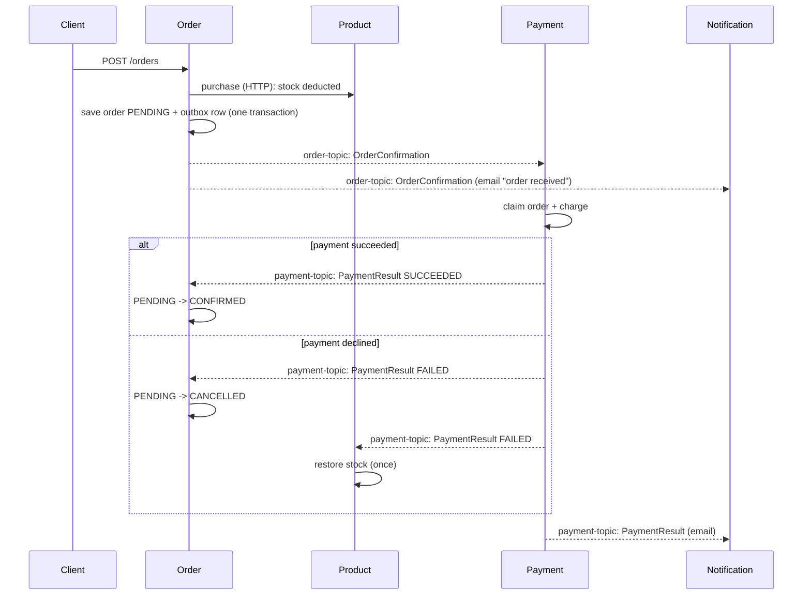

# Order saga (choreography)

## Temporary states
| Moment | What is true | Who can observe it |
|---|---|---|
| After POST /orders | Order PENDING, stock already deducted | Client (GET /orders/{id}) |
| Payment done, result not consumed yet | Payment SUCCEEDED, Order still PENDING | Anyone reading both services |
| Payment declined, compensation pending | Order PENDING (or CANCELLED), stock still low | Product catalog readers |
| Payment service down | Order stays PENDING, events wait in Kafka | Client |

## Rules
- Every step is a local transaction + an outbox event. No distributed transaction.
- Every consumer is idempotent: events are delivered at-least-once.
- Order state machine: PENDING -> CONFIRMED | CANCELLED. Nothing else.